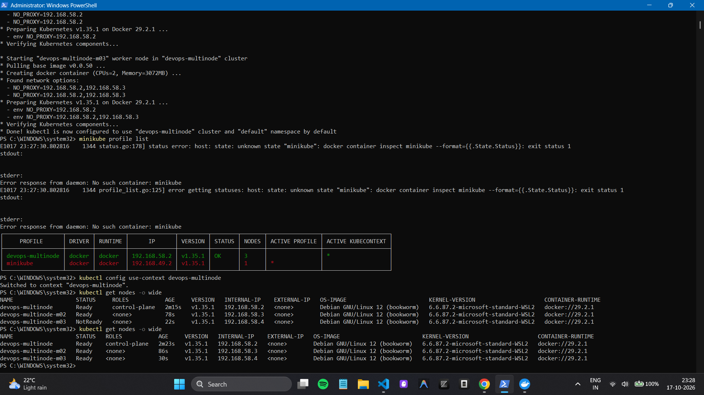
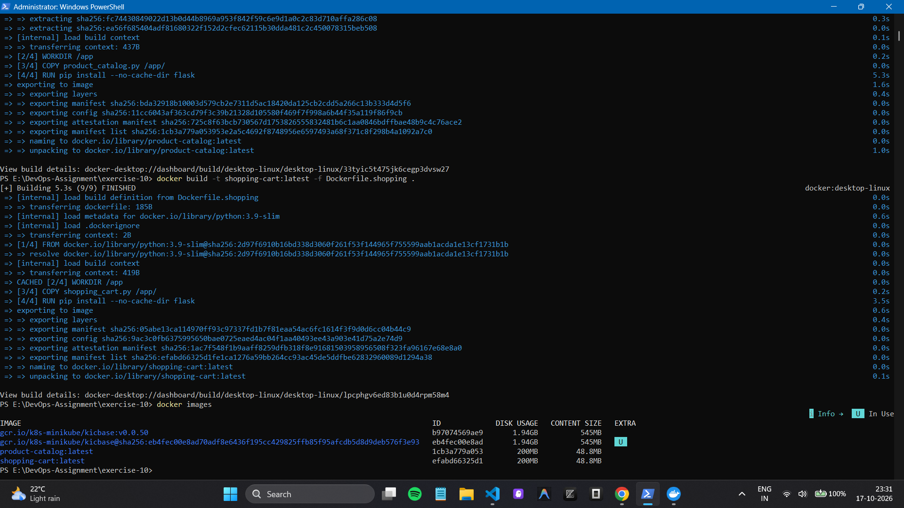
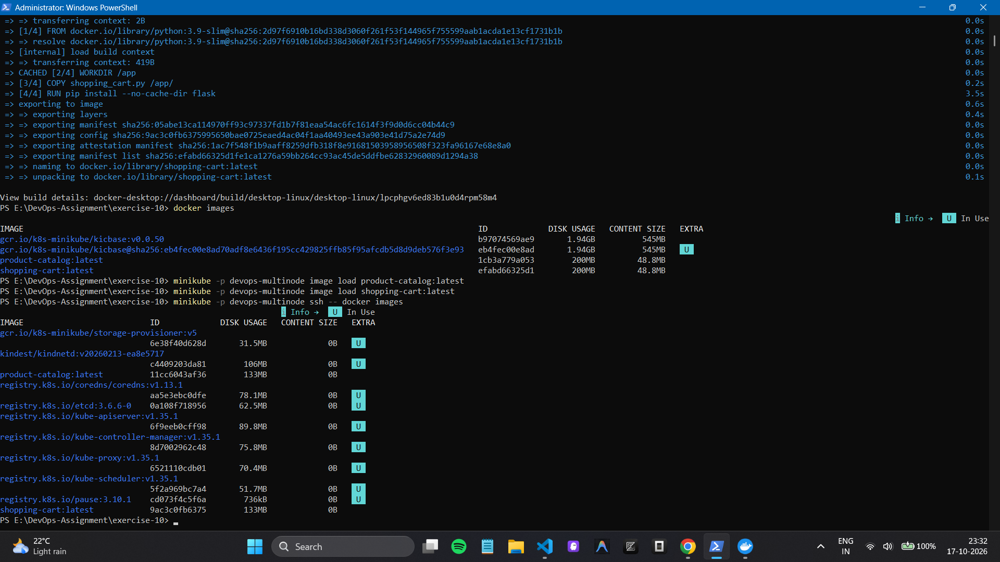
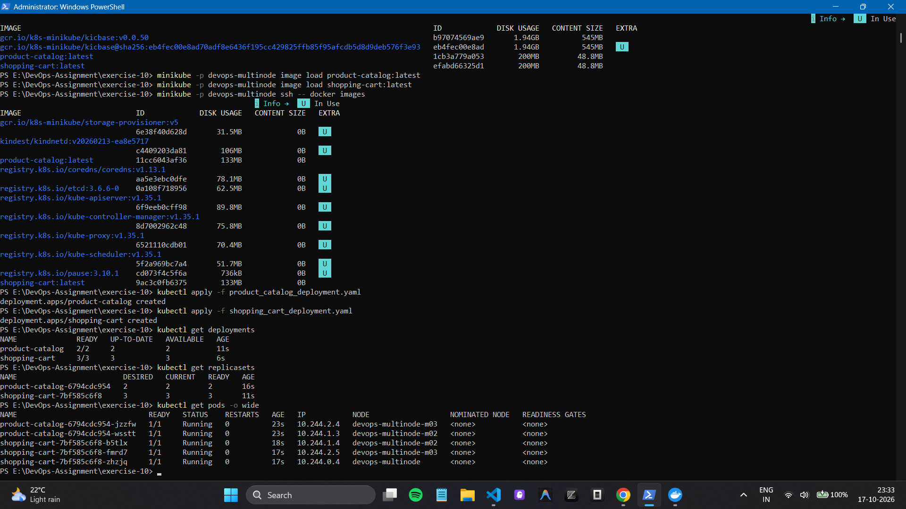
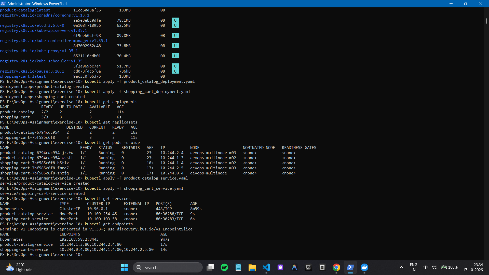
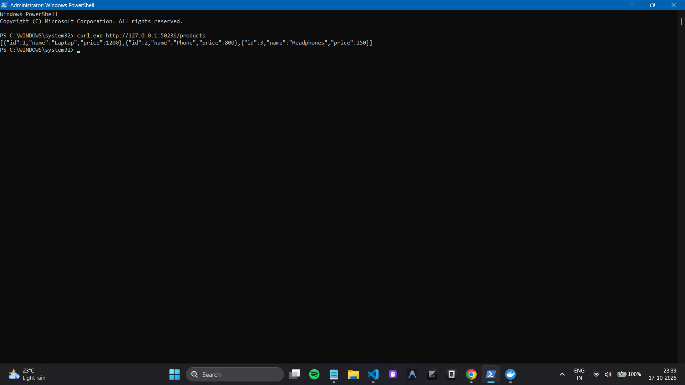
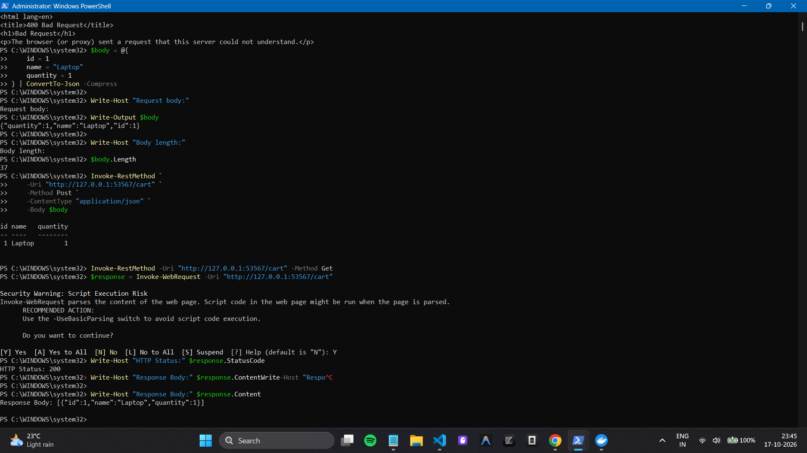

# Multi-Node Kubernetes Cluster with Multiple Applications

## Overview

Deployed two Flask applications on a three-node Minikube cluster using
Docker images, Kubernetes Deployments, ReplicaSets, pod anti-affinity,
and NodePort Services.

-   **Product Catalog:** 2 replicas
-   **Shopping Cart:** 3 replicas
-   **Cluster:** 3 Minikube nodes
-   **Result:** All 5 application pods reached `Running` with zero
    restarts.

## Architecture

-   `product-catalog` Deployment → 2 pods
-   `shopping-cart` Deployment → 3 pods
-   `product-catalog-service` → NodePort
-   `shopping-cart-service` → NodePort
-   Required pod anti-affinity distributes replicas of each application
    across separate nodes.

## Implementation

1.  Created the Flask Product Catalog and Shopping Cart APIs.
2.  Built Docker images: `product-catalog:latest` and
    `shopping-cart:latest`.
3.  Loaded both images into the `devops-multinode` Minikube profile.
4.  Applied Kubernetes Deployments and Services.
5.  Verified pod status, replica counts, node distribution, and API
    responses.

## Verification

-   Product Catalog `GET /products` returned the laptop, phone, and
    headphones.
-   Shopping Cart `POST /cart` successfully added a Laptop item.
-   Shopping Cart `GET /cart` returned the added item with quantity `1`.
-   Both Deployments reached their desired available replica counts
    (`2/2` and `3/3`).

## Screenshots

The following screenshots document the important execution steps and successful outcomes.

### 1. Three-node Minikube cluster



### 2. Docker images built



### 3. Images available in Minikube



### 4. Five running pods distributed across nodes



### 5. Kubernetes Services



### 6. Product Catalog API response



### 7. Shopping Cart POST and GET responses



## Commands Used

``` powershell
kubectl get deployments
kubectl get replicasets
kubectl get pods -o wide
kubectl get services
kubectl get endpoints
```

## Conclusion

Successfully deployed and tested two replicated Flask applications on a
three-node Kubernetes cluster. Pod anti-affinity distributed each
application's replicas across different nodes, and both Services exposed
the applications for API testing.
