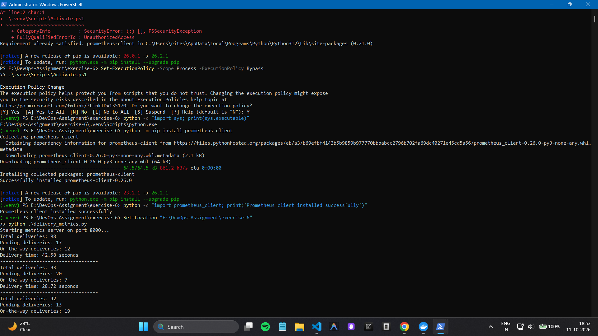
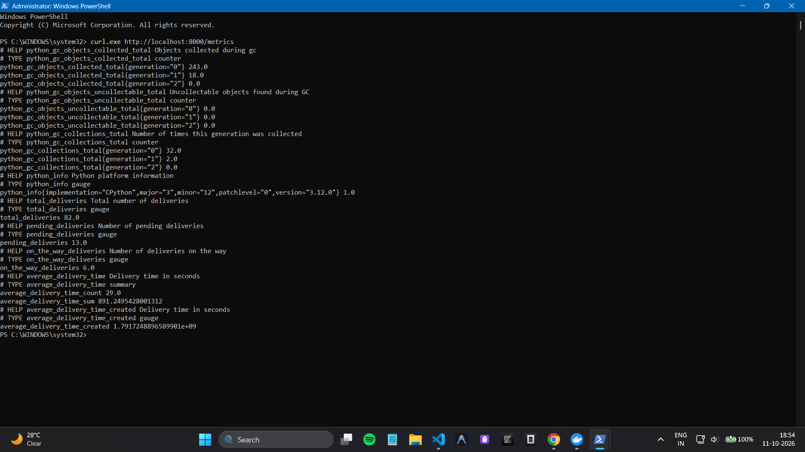
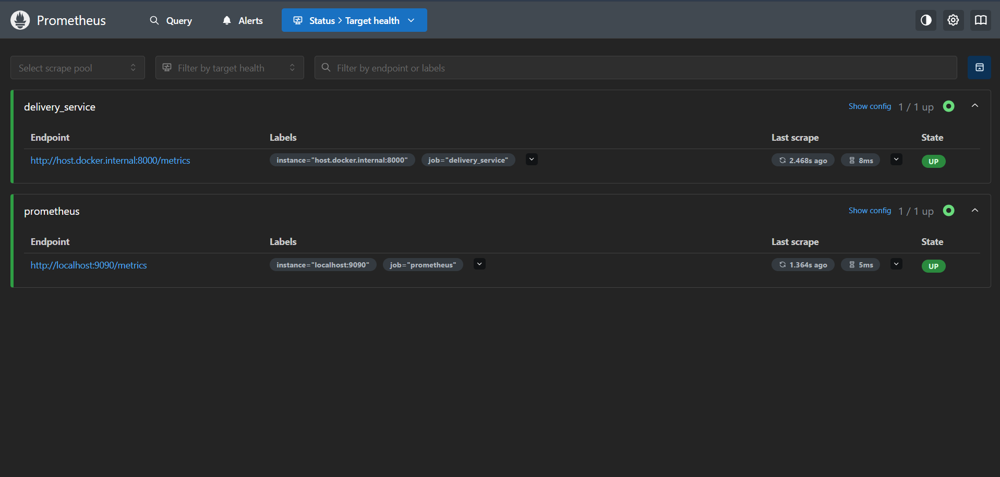
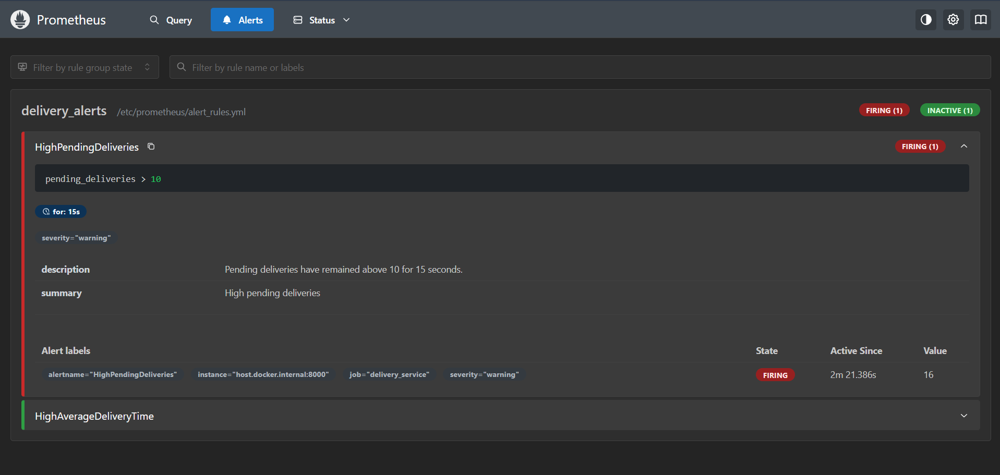
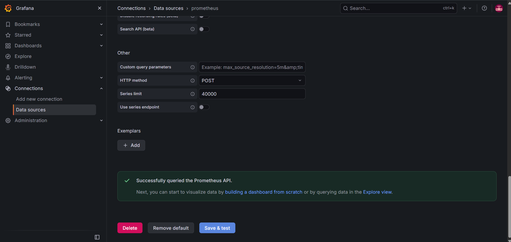
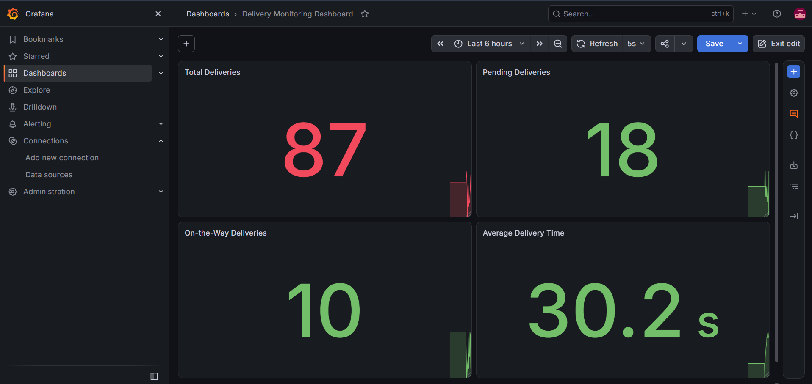
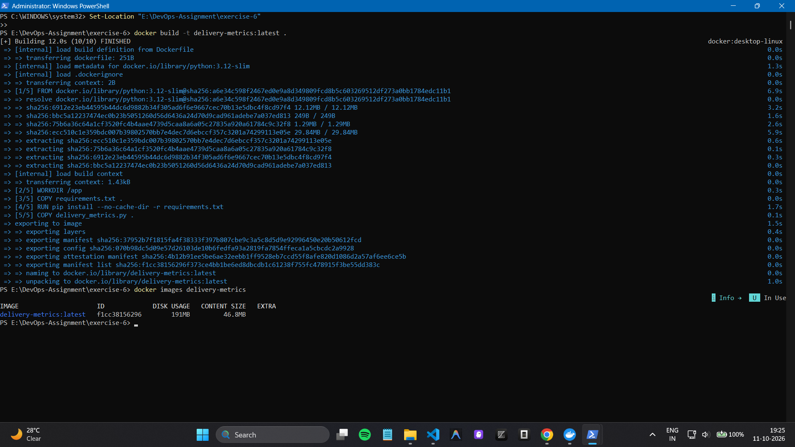
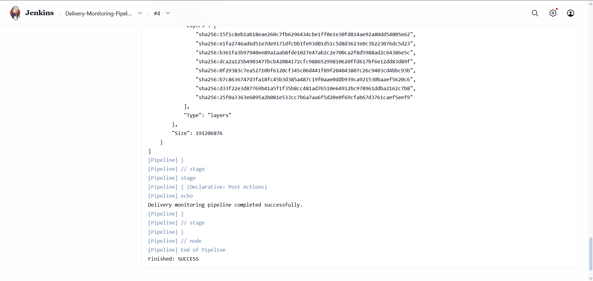

# Real-Time Operations Monitoring and Alerting

## Overview
This exercise builds a delivery-service monitoring pipeline using Python, Prometheus, Grafana, Docker, and Jenkins. The Python application simulates delivery metrics, Prometheus scrapes and evaluates alert rules, Grafana visualizes the metrics, and Jenkins automates validation and Docker image builds.

## Architecture
- **Python:** Generates delivery metrics on port `8000`.
- **Prometheus:** Scrapes metrics and evaluates alert rules on port `9090`.
- **Grafana:** Displays delivery metrics on port `3000`.
- **Docker:** Runs Prometheus, Grafana, Jenkins, and builds the delivery application image.
- **Jenkins:** Runs a pipeline to check Docker, validate project files, build the image, and verify monitoring services on port `8080`.

## Project Files
- `delivery_metrics.py` — Simulates total, pending, and on-the-way deliveries, plus delivery-time observations.
- `requirements.txt` — Python dependency list.
- `Dockerfile` — Builds the Python metrics application image.
- `Dockerfile.jenkins` — Builds the Jenkins image with Docker CLI.
- `prometheus.yml` — Configures Prometheus scraping and alert-rule loading.
- `alert_rules.yml` — Defines `HighPendingDeliveries` and `HighAverageDeliveryTime` alerts.
- `images/` — Contains the eight exercise screenshots referenced below.

## Setup and Run

### 1. Run the Python metrics application
From PowerShell in the project directory:

```powershell
python -m venv .venv
.\.venv\Scripts\Activate.ps1
python -m pip install -r requirements.txt
python .\delivery_metrics.py
```

The metrics endpoint is available at [http://localhost:8000/metrics](http://localhost:8000/metrics). Keep the Python process running while testing Prometheus and Grafana.

### 2. Run Prometheus
Prometheus is configured using `prometheus.yml` and `alert_rules.yml`. In this Windows Docker Desktop setup, the delivery application target is `host.docker.internal:8000`. Prometheus UI: [http://localhost:9090](http://localhost:9090).

### 3. Run Grafana
Grafana UI: [http://localhost:3000](http://localhost:3000). Configure the Prometheus data source URL as `http://host.docker.internal:9090`. The dashboard contains:
- `total_deliveries`
- `pending_deliveries`
- `on_the_way_deliveries`
- `average_delivery_time_sum / average_delivery_time_count`

Set dashboard auto-refresh to 5 seconds to observe updates.

### 4. Jenkins pipeline
Jenkins UI: [http://localhost:8080](http://localhost:8080). The `Delivery-Monitoring-Pipeline` checks Docker access, validates project files, builds `delivery-metrics:latest`, and verifies the monitoring containers and image.

> **Note:** The local lab configured Jenkins to run as root with access to the Docker socket so it could control Docker Desktop. This grants broad control over Docker and should not be used for an untrusted or production Jenkins deployment.

## Alert Rules
- **HighPendingDeliveries:** Fires when `pending_deliveries > 10` remains true for 15 seconds.
- **HighAverageDeliveryTime:** Fires when `(average_delivery_time_sum / average_delivery_time_count) > 30` remains true for 15 seconds.

## Screenshots
Place these image files in the `images` directory. The filenames below are numbered as requested.

1. **Python metrics application running** — 
2. **Metrics endpoint output** — 
3. **Prometheus targets showing both jobs UP** — 
4. **Prometheus alerts showing the pending-delivery alert firing** — 
5. **Grafana Prometheus data source connection successful** — 
6. **Grafana delivery monitoring dashboard with four panels** — 
7. **Docker image build completed** — 
8. **Jenkins pipeline successful build and console output** — 
