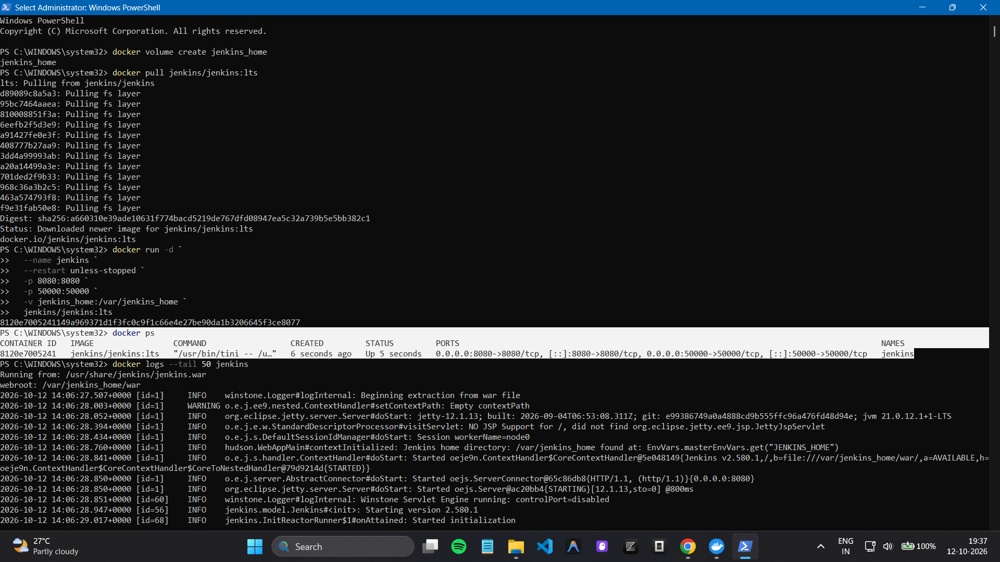
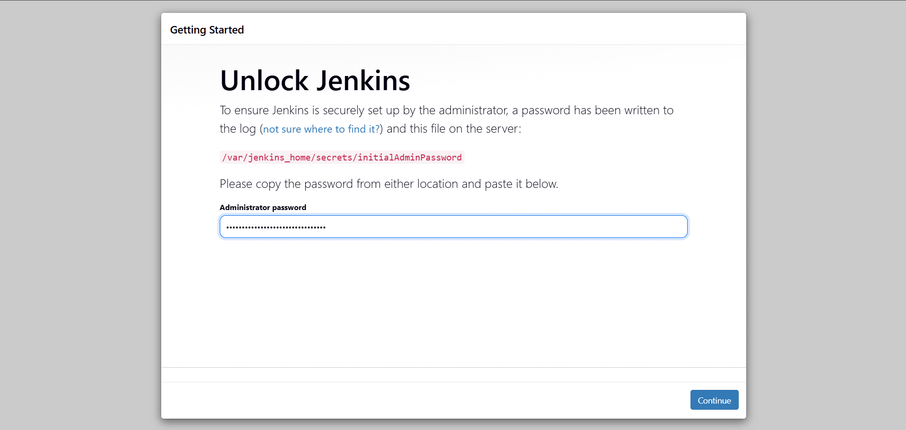
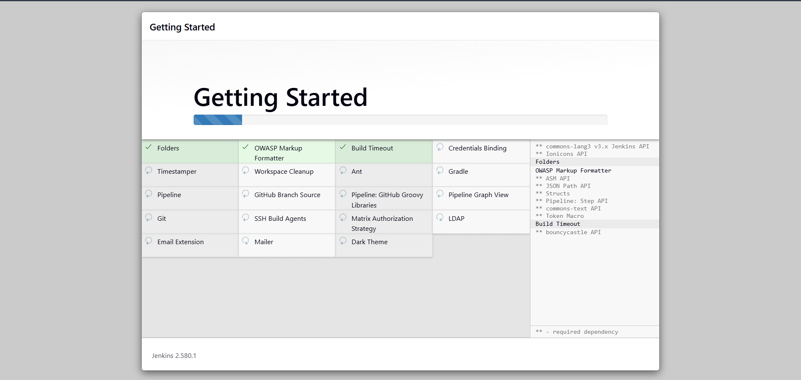
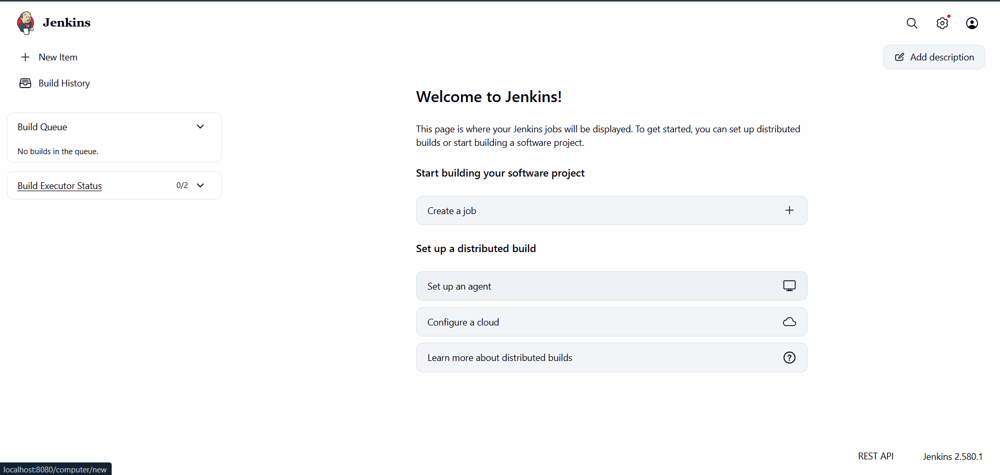

# Introduction to CI and Jenkins Installation

## Overview
Continuous Integration (CI) is a development practice in which developers frequently integrate code into a shared repository. Automated builds and tests help detect errors early and provide quick feedback.

Jenkins is an open-source automation server used to build, test, and deploy software. Its functionality can be extended through plugins.

## Key CI Concepts
- **Frequent integration:** Developers regularly push code changes to a shared repository.
- **Automated builds and tests:** Changes are built and tested automatically.
- **Immediate feedback:** Results help developers identify issues early.
- **Common CI tools:** Jenkins, GitLab CI/CD, CircleCI, Travis CI, Bamboo, TeamCity, Azure Pipelines, GitHub Actions, Spinnaker, Buildkite, and Drone.

## Jenkins Concepts
- **Job:** A task executed by Jenkins.
- **Build:** An execution of a job or pipeline.
- **Pipeline:** A sequence of automated build, test, and deployment steps.
- **Plugins:** Extensions that add functionality and integrations.
- **Nodes:** Machines on which Jenkins jobs run.

## Installation Using Docker Desktop
Jenkins was installed locally on Windows using Docker Desktop and PowerShell.

```powershell
docker volume create jenkins_home
docker pull jenkins/jenkins:lts

docker run -d `
  --name jenkins `
  --restart unless-stopped `
  -p 8080:8080 `
  -p 50000:50000 `
  -v jenkins_home:/var/jenkins_home `
  jenkins/jenkins:lts
```

The Jenkins web interface is available at: http://localhost:8080

The initial administrator password can be retrieved with:

```powershell
docker exec jenkins cat /var/jenkins_home/secrets/initialAdminPassword
```

After unlocking Jenkins, the suggested plugins were installed, an administrator account was created, and the setup wizard was completed.

## Screenshots
Place the four screenshots in the same directory as this README, using the filenames below.

### 1. Jenkins Container Running


### 2. Unlock Jenkins


### 3. Suggested Plugin Installation


### 4. Jenkins Dashboard


## Verification
The following PowerShell commands can be used to verify the container and persistent volume:

```powershell
docker ps
docker inspect jenkins --format '{{.State.Status}}'
docker volume inspect jenkins_home
```

The expected container state is `running`. The named volume `jenkins_home` stores Jenkins data across container recreation.

## Result
Jenkins was installed and configured successfully using Docker Desktop on Windows, and the Jenkins dashboard was accessed through the browser.
