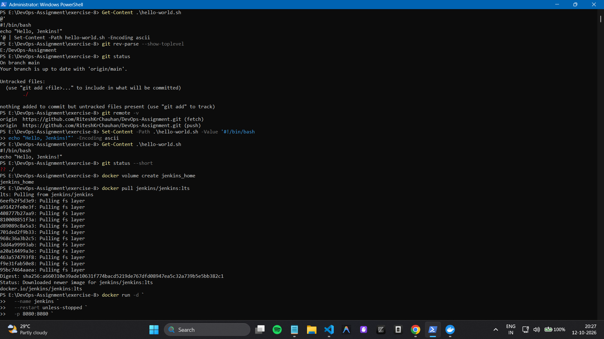
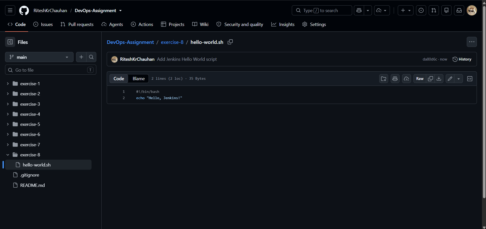
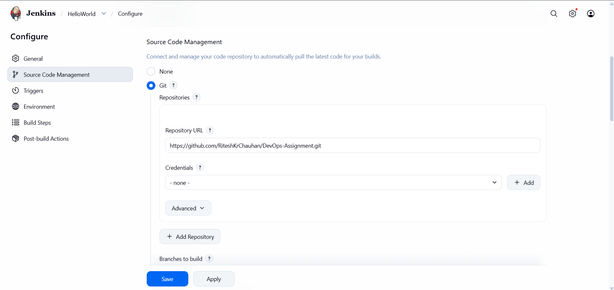
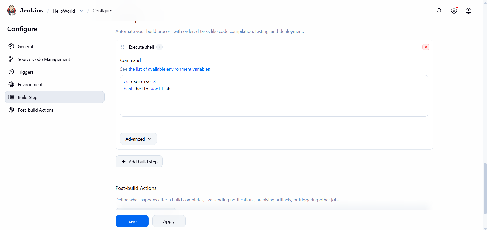
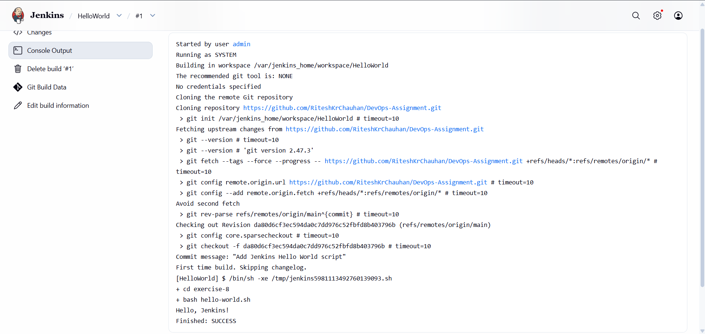

# Exercise 8: Creating a Hello World Jenkins Job

## Objective
Create and run a Jenkins Freestyle job that retrieves a shell script from GitHub and prints `Hello, Jenkins!`.

## Tools Used
- Windows PowerShell
- Docker Desktop
- Jenkins
- Git and GitHub
- Visual Studio Code

## Procedure
1. Created `hello-world.sh` with the following contents:
   ```bash
   #!/bin/bash
   echo "Hello, Jenkins!"
   ```
2. Committed and pushed the script to the [DevOps-Assignment GitHub repository](https://github.com/RiteshKrChauhan/DevOps-Assignment).
3. Created a Jenkins Freestyle job named `HelloWorld`.
4. Configured Git source control to use the repository's `main` branch.
5. Configured the build step:
   ```bash
   cd exercise-8
   bash hello-world.sh
   ```
6. Ran the job and checked the console output.

## Screenshots

### 1. Script created in VS Code


### 2. Script available on GitHub


### 3. Jenkins job configuration


### 4. Git and build-step configuration


### 5. Successful Jenkins build


## Result
The Jenkins job executed the script and printed `Hello, Jenkins!`. The build completed successfully (`Finished: SUCCESS`).
