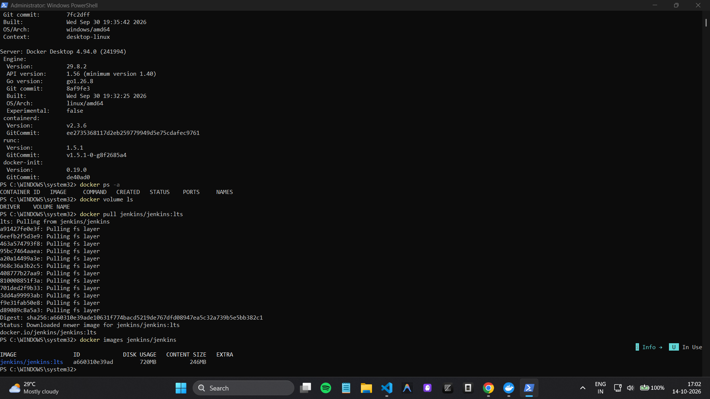
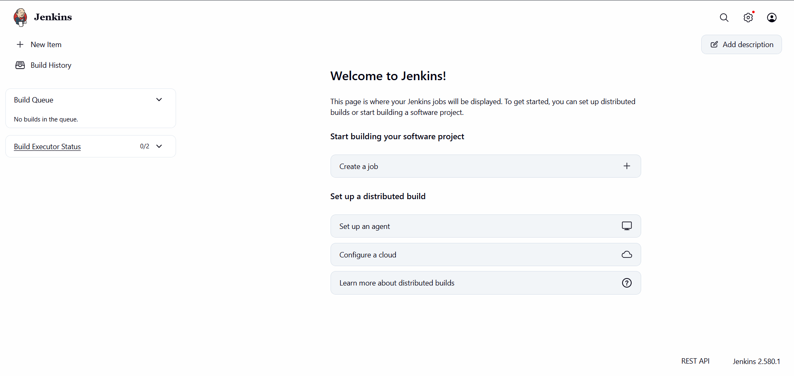
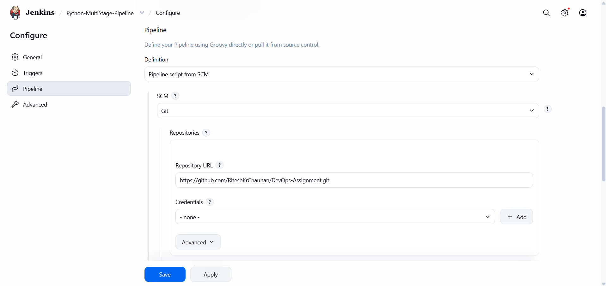
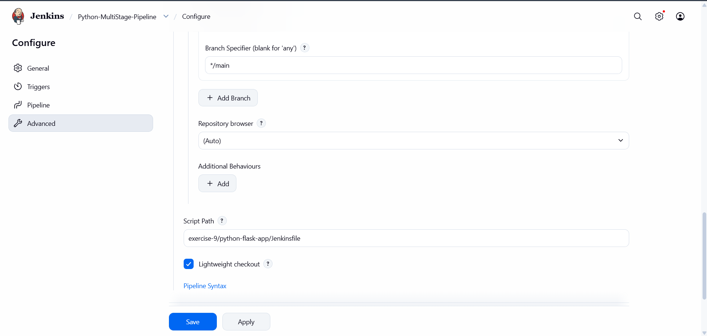
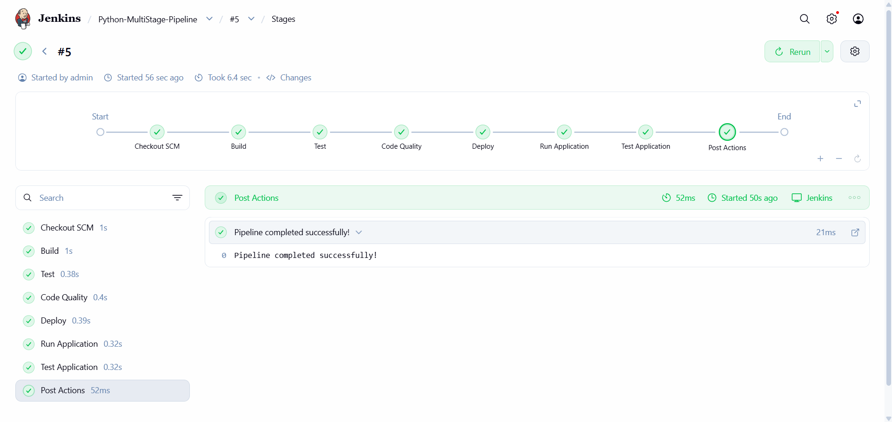
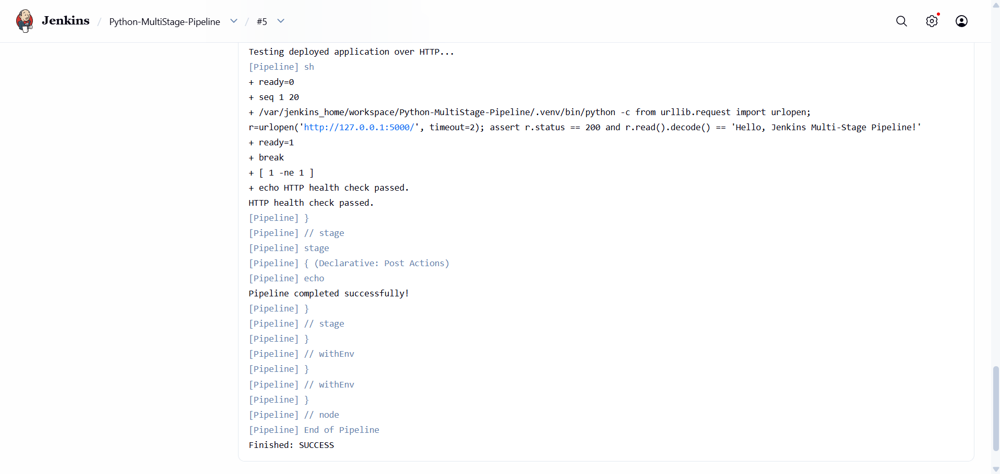

# Jenkins Multi-Stage Pipeline — Python Flask

Automates build, testing, code-quality checks, and mock deployment of a Flask app using Jenkins in Docker.

## Pipeline stages

1. **Build** — create a Python virtual environment and install dependencies.
2. **Test** — run unit tests with `unittest`.
3. **Code Quality** — run Flake8.
4. **Deploy** — copy `app.py` to a mock deployment directory.
5. **Run Application** — start the Flask app in the Jenkins container.
6. **Test Application** — verify the HTTP response with a health check.

## Result

**Successful:** all pipeline stages passed, the unit test passed, Flake8 reported no issues, and the HTTP health check succeeded.

## Screenshots

### 1. Docker and Jenkins setup

### 2. Jenkins dashboard

### 3. Pipeline configuration

### 4. Branch and Jenkinsfile path

### 5. Successful pipeline stages

### 6. Console output — SUCCESS

